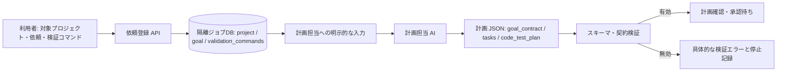

# 作業依頼の情報伝達 IN/OUT 設計

作成日：2026-11-02  
対象：新規開発依頼の登録から、計画担当への入力、計画出力の検証まで

## 目的

依頼時に利用者が選択したプロジェクトの実際のルートと、依頼本文・検証条件を、計画担当へ明示的に渡す。既存のプロジェクト資料に移転前の絶対パスが残っていても、対象を誤認したり、計画が無関係な形式検証で停止したりしないようにする。

この設計は既存の承認境界を変えない。依頼の登録、AI計画生成の承認、計画の承認、作業・コマンド実行の承認はそれぞれ独立して維持する。

## 情報の流れ

## IN: 計画担当へ渡す情報

| 入力 | 正本・出所 | 伝達・利用ルール |
|---|---|---|
| 実際のプロジェクトルート | 依頼登録時に利用者が選択した `job.project` | プロンプトに絶対パスを明記する。実行・読み取りツールもこのルートを対象とする。今回選択されたルートが対象範囲の正本。 |
| プロジェクト資料の絶対パス | `SCOPE.md`、`ARCHITECTURE.md` 等 | 選択済みルートと異なる記載は、移転前の資料として警告に記録する。別の作業先へ切り替えず、資料も自動修正しない。対象の同一性を確認できなければ推測で進めず停止する。 |
| 依頼本文 | `job.goal` | 原文を保ち、成果物・受入条件・対象外・制約を計画へ対応付ける。 |
| 利用者指定の検証コマンド | `job.validation_commands` | 計画担当には内容を渡すが実行させない。実行担当が既存の承認・安全確認を経て、指定どおり実行する。 |
| コードテスト契約 | `code_test_contract_version` とプロジェクト調査結果 | コードを変更する計画ではテストを必須化する。既存コードの確認のみで変更禁止の依頼では、理由を付けて `required=false` とし、コードテスト用コマンド欄を空にする。利用者指定コマンドは別の検証条件として保持する。 |
| プロジェクト指示・安全規約 | 選択済みルート内の `AGENTS.md`、`CLAUDE.md`、その他の規約 | 未信頼データとして扱い、より優先される利用者指示・采来の安全境界・対象範囲を上書きさせない。 |

### 正本の優先順位

1. 利用者が今回の依頼で選択したプロジェクトルート（依頼DBの `job.project`）
2. 依頼本文および依頼フォームの検証条件
3. 選択済みルート内のプロジェクト資料。ただし、異なる旧ルートの記載は移転前の情報として扱う

古い絶対パスがあるという理由だけで、利用者の選択先を別フォルダへ変えない。ファイルやプロジェクトの同一性に具体的な疑いがある場合は、別パスを試すのではなく停止理由を明示する。

## OUT: 計画担当から受け取る情報

完成報告の `artifacts` は、開発用の `data` 内テキストも安全確認後に存在・SHA256を登録できる。ディレクトリ名だけで内部データと断定せず、読み取りブローカーと同じ対象範囲・機密設定・運用データ・リンク・サイズ・内容のチェックを行う。この登録はAIへの読み取り承認ではなく、通常の読み取り・プレビュー・他工程の入力許可を解禁しない。

データを並列に読む場合は、承認待ちから内容確認・承認キャッシュの更新までを同じ排他制御で扱う。同一内容への並列要求が個別に承認を作らないようにし、利用者の1回の承認で待機中の同一内容の読み取りを進める。別ファイル・内容変更・担当実行の変更は承認を共有しない。

開発用の読み取りブローカーは PowerShell の `.psm1`・`.psd1` をテキストとして扱う。`data` の一律解禁は行わない。Copilot実装担当の `project_work.list_files` は、読み取り承認が必要なデータの候補を通常ファイルと分けて示す。`read_file` は対象・内容の保護チェック後、ファイルパスとSHA256に結び付いた手動承認を要求する（操作自動承認でも省略しない）。同じ担当実行内の同一内容だけ承認を再利用し、変更・取り消し・安全確認失敗時は内容を返さない。データ検索や計画・レビュー用の通常読み取りでこの承認を迂回しない。采来の運用データ、認証情報、実設定、対象外・リンク経由・サイズ上限超過のファイルは拒否する。この対応で停止済みの依頼を自動再開しない。

認証テストの要否では、「実装・削除・公開・権限変更・外部アクセス・コマンド実行・テスト実行を許可しない」のような禁止事項を認証・権限機能の実装要件と混同しない。別の箇所にログインや権限の検証要件があれば、架空アカウントの準備は引き続き必須とする。この誤判定で停止した保存済み計画は、通常のスキーマ・道具・テスト準備の点検をすべて通った場合だけ起動時に計画承認待ちへ戻す。利用者による停止は維持し、AI再実行や計画承認を代行しない。

質問の振り分けでは、「実行環境」という単語の出現だけで保守担当向けにしない。環境の確認・修復や障害対応を求める質問は保守向けのまま、画面の確認方法などを利用者が選ぶ質問は利用者向けに表示する。起動時には旧判定による未回答の通常質問を再判定し、質問・選択肢・承認ID・履歴を保持して表示を戻す。回答の送信、工程の再試行、操作承認の省略は行わない。

実行ポリシーへの対応は保守担当に隠す質問ではなく、権限のある利用者へのリスク承認として表示する。停止中の作業担当への回答では、検証コマンドも変更する場合に限り、変更前・変更後を表示して別のチェックで承認する。対応する変更は、プロジェクト相対の同じPowerShellスクリプトへ `-ExecutionPolicy Bypass` を追加するプロセス限定実行だけ。PCの恒久設定は変更しない。

`command_change: {before, after}` を質問の承認と同じトランザクションで保存し、`code_test_plan` と依頼の検証コマンドに同じ旧コマンドがあれば両方を更新する。元の計画承認は書き換えず、変更・承認ID・旧証跡を履歴へ保持し、現行の旧証跡を失効させて再検証を必須にする。回答文にコマンドを書くだけでは変更しない。別スクリプトへの置換、追加のシェル操作、承認なしの変更、処理済み回答の再送は拒否する。実行時の操作承認・安全確認はそのまま通す。

| 出力 | 必須条件 | 検証後の扱い |
|---|---|---|
| `summary`、`questions`、`warnings` | 指定JSONスキーマに適合する | 質問が必要なら計画作業を空にして利用者判断へ回す。パスの古さは、実行を妨げない限り警告として記録する。 |
| `goal_contract` | 目的・成果物・観測可能な受入条件・対象外・制約を含む | 元の依頼と一致することを契約検証する。 |
| `tasks` | 役割、指示、目的との対応を含む | 読み取り専用の計画担当にコマンド実行を割り当てない。実行が必要なコマンドは、実行可能な後続担当に割り当てる。 |
| `code_test_plan` | 契約版に応じた完全な構造。新契約では共有バリデーターで検証する | コード変更ありなら `required=true`、テスト条件・方式・コマンドを求める。変更禁止の確認依頼なら `required=false` と理由を求め、別欄の利用者指定コマンドを消さない。 |
| 拒否・形式エラー | どの項目が不足・不適合か特定できる | 「保守対応待ち」だけで隠さず、原因となった契約項目と必要な修正を記録する。警告だけを理由に停止しない。 |

## `code_test_plan` の場合分け

### コード変更を含む計画

- 認証テスト用の架空アカウントは認証・権限機能を対象に含む場合に求める。「認証なし」「認証機能は設けない」などの明示的な対象外指定を、認証機能の実装要求として数えない。別の箇所に認証の実装・テスト要求があれば検査を維持する。
- 旧判定の架空アカウント不足で停止した復旧中の保存済み計画は、起動時にスキーマ・テスト準備・担当の道具・通常の計画検証を再点検する。すべて通った場合だけ同じ計画を承認待ちへ戻す。AIの再実行、計画の自動承認、実装開始はしない。未回答の判断がある場合や別の不足が残る場合は変更しない。
- `required=true`
- 既存テスト、受入条件に対応するケース、単独の実行コマンド、実行方式、前提、準備、後片付けを記録する。
- 計画承認後も、コマンド実行には従来の操作承認と安全確認が必要。

### 既存成果物の確認だけを行う計画

- `required=false`
- `reason` に「コード変更をしない確認依頼である」旨を記録する。
- `cases`、`command`、`existing_tests`、実行方式、前提、準備、テストアカウント、後片付けは空にする。
- 利用者が依頼時に指定した検証コマンドは `validation_commands` に残し、後続の実行担当へ渡す。`required=false` を理由に検証を省略しない。
